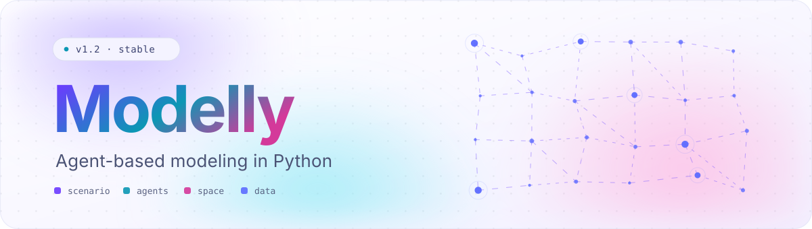
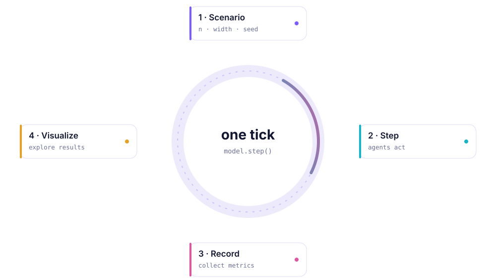
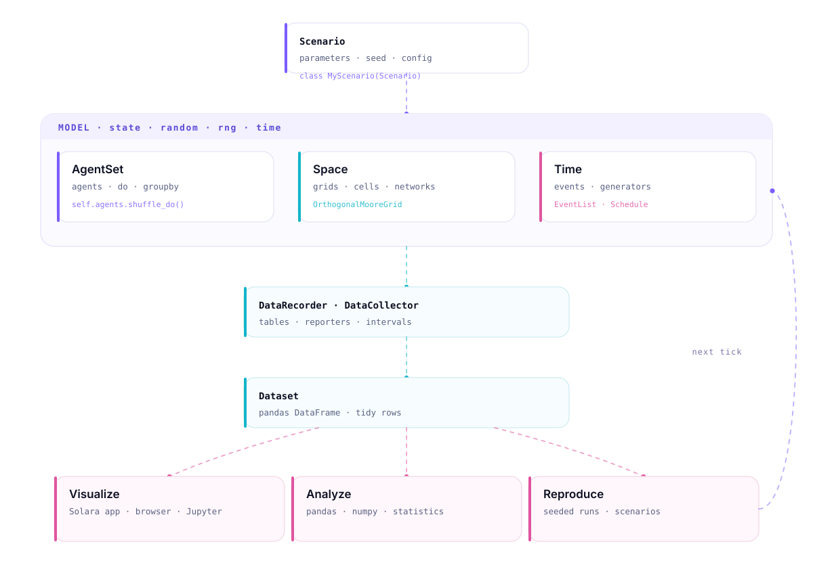

<p align="center">
  <picture>
    <source media="(prefers-color-scheme: dark)" srcset="docs/images/branding/banner-dark.svg">
    <source media="(prefers-color-scheme: light)" srcset="docs/images/branding/banner-light.svg">
    
  </picture>
</p>

<p align="center">
  <a href="https://github.com/RemiPelloux/Modelly/actions/workflows/build_lint.yml"></a>
  <a href="https://codecov.io/gh/RemiPelloux/Modelly"></a>
  
  
  <a href="pelloux-guidelines.md"></a>
  <a href="LICENSE"></a>
</p>

<p align="center"><b>Modelly</b> is a Python framework for <b>agent-based modeling</b>: declare a scenario,
give your agents behaviour, run the world forward in time, then measure, replay and publish it.</p>

---

**Status:** alpha, Python 3.12+. The core (model, agents, spaces, time, data) is stable enough for
research use; modules under `modelly.experimental` may still change between minor versions.

```bash
pip install -e ".[all]" && python example.py      # a wealth-exchange model, Gini after 100 ticks
```

## Vision

Agent-based models are how researchers study systems whose behaviour emerges from many
interacting parts: markets, epidemics, ecosystems, cities, opinions. The models are easy to
describe and hard to keep correct, reproducible and fast. Modelly exists to remove that gap.

**What we are building**

- **A research instrument, not a toy.** Every run is seeded, every parameter lives in a typed
  scenario, every dataset lands in pandas. A result you got once is a result you can get again.
- **Fast by construction.** The hot paths of a simulation (activating agents, moving them,
  looking up neighbours, recording data) are measured, benchmarked in CI, and written so the cost
  per agent-step stays flat as models grow. Performance is a feature with a test, not a hope.
- **Small, readable modules.** A researcher should be able to open any file and understand it in
  one sitting. Files stay under 300 lines, functions under 25, and the rule is enforced by a script,
  not by goodwill. The [Pelloux guidelines](pelloux-guidelines.md) are the contract.
- **One mental model from notebook to cluster.** The same scenario object drives a quick look in a
  notebook, a browser visualization, a parameter sweep and a batch of replications.

**Where we are going.** The current engine keeps one Python object per agent, which is what makes
models easy to write. The next steps on the roadmap keep that authoring model while moving the
heavy lifting into arrays: columnar agent state with vectorised reporters, a spatial index for
continuous space so neighbour queries stop being all-pairs, and parallel replications out of the
box. The [performance audit](docs/performance.md) records what has been done and what is next.

## Why Modelly

Modelly gives you the boring, load-bearing parts as small composable objects, so your model file
reads like the description of the system instead of the plumbing around it:

| | |
|---|---|
| **Scenario** | Parameters as a typed class: one run, one seed, one config object |
| **Agents** | Typed agent classes with `step()` behaviour, grouped in ordered `AgentSet`s |
| **Space** | Orthogonal / hexagonal grids, cells, networks, Voronoi meshes, continuous space |
| **Time** | Discrete ticks, events, generators and priorities in one scheduler |
| **Data** | Reporters and datasets that land in pandas, ready to plot |
| **Front end** | Browser visualization (Solara), static charts, notebooks |

No global state, no hidden step order, no bespoke loops: reproducibility is the default.

<p align="center">
  
</p>

## Install

Modelly requires **Python 3.12+**.

```bash
git clone https://github.com/RemiPelloux/Modelly.git
cd Modelly

python -m venv .venv && source .venv/bin/activate
pip install -e ".[all]"          # core + network + visualization + examples + docs
```

Pick only what you need if `all` is too much:

```bash
pip install -e .                 # core: numpy, pandas, scipy, tqdm
pip install -e ".[viz]"          # + solara, matplotlib, altair
pip install -e ".[network]"      # + networkx
```

## A model in 30 seconds

> Runs as-is: `python example.py` prints the Gini coefficient rising.

```python
from modelly import Model
from modelly.discrete_space import CellAgent, OrthogonalMooreGrid
from modelly.experimental.scenarios import Scenario


class WealthScenario(Scenario):
    """Everything that can vary between runs lives here."""

    n: int = 120
    width: int = 12
    height: int = 12


class MoneyAgent(CellAgent):
    def __init__(self, model, cell):
        super().__init__(model)
        self.cell = cell
        self.wealth = 1

    def step(self):
        self.cell = self.cell.neighborhood.select_random_cell()
        cellmates = [a for a in self.cell.agents if a is not self]
        if self.wealth > 0 and cellmates:
            self.random.choice(cellmates).wealth += 1
            self.wealth -= 1


class WealthModel(Model):
    def __init__(self, scenario: WealthScenario = WealthScenario):
        super().__init__(scenario=scenario)
        self.grid = OrthogonalMooreGrid(
            (scenario.width, scenario.height), random=self.random
        )
        MoneyAgent.create_agents(
            self,
            scenario.n,
            self.random.choices(self.grid.all_cells.cells, k=scenario.n),
        )

    def step(self):
        self.agents.shuffle_do("step")  # every agent, in random order

    @property
    def gini(self):
        x, n = sorted(a.wealth for a in self.agents), len(self.agents)
        return (
            1 + 1 / n - 2 * sum(xi * (n - i) for i, xi in enumerate(x)) / (n * sum(x))
        )


model = WealthModel()
for _ in range(100):
    model.step()

print(model.gini)  # 0.0 at t=0 ... ~0.6 after 100 ticks
```

Three pieces, and nothing else: a **scenario** of inputs, **agents** that know one thing each,
and a **model** that owns the world and advances it.

## Record it, then look at it

```python
from modelly.datacollection import DataCollector


class WealthModel(Model):
    def __init__(self, scenario: WealthScenario = WealthScenario):
        super().__init__(scenario=scenario)
        # ... grid and agents as above ...
        self.datacollector = DataCollector(
            model_reporters={"Gini": "gini"},  # anything reachable from the model
            agent_reporters={"Wealth": "wealth"},  # anything on each agent
        )

    def step(self):
        self.agents.shuffle_do("step")
        self.datacollector.collect(self)  # one row per tick
```

```python
model_vars = model.datacollector.get_model_vars_dataframe()  # Gini per tick
agent_vars = model.datacollector.get_agent_vars_dataframe()  # wealth per agent per tick
agent_vars.groupby("Step")["Wealth"].mean().plot()
```

Both frames are plain pandas, so everything you already know how to do keeps working.
Attribute reporters are gathered in C (`operator.attrgetter`), so a string reporter is the fast
path, not just the convenient one.

## Architecture

<p align="center">
  
</p>

- **Scenario to Model.** Inputs enter through one typed object; the model owns state, seed, RNG and time.
- **Model to AgentSet / Space / Time.** Agents live in sets, act inside some space, and are driven by the scheduler.
- **Model to Dataset.** Reporters sample the model and its agents on intervals you choose.
- **Dataset to Visualize / Analyze / Reproduce.** Same data, three exits: a browser app, a dataframe, or a seeded re-run.

## How the engine stays fast

The data structures are chosen for the operations a simulation actually performs, and each choice
is backed by a measurement in [docs/performance.md](docs/performance.md).

| Structure | Backed by | Why |
|---|---|---|
| `AgentSet` (every view) | ordered `dict` keyed on `weakref.ref` | O(1) membership and removal, stable order for reproducible shuffles, no zombie agents; half the cost of `WeakKeyDictionary` |
| `model.agents` (the registry) | ordered `dict` keyed on the agent | Strong references where the lifecycle is explicit; views downgrade to weak sets in one place |
| `Cell.agents` | `list` | Cells hold a handful of agents; append and remove beat any indexed structure at that size |
| Cell neighbourhoods | per-cell `dict` cache | One lookup per query; invalidating one cell never touches another, and a discarded grid is freed |
| Empty cells on a grid | swap-remove list + index | O(1) random empty cell at any fill level, built lazily the first time a grid turns out to be dense |
| Property layers | `np.ndarray` per layer | Vectorised updates on the array, per-cell accessors on the cells, one source of truth |
| Continuous space | one `np.ndarray` of positions | Distance queries are numpy operations, agents index into the array |
| Event queue | `heapq` with lazy cancellation and compaction | O(log n) scheduling that never degrades under repeated cancel/reschedule |

## Benchmarks

`benchmarks/global_benchmark.py` times the bundled reference models and runs in CI. The latest
audit (CPU time per step, large configurations, same machine before and after) is summarised
here; the full table and method are in [docs/performance.md](docs/performance.md).

| Model | Agents | Per step | Change |
|---|---|---|---|
| Boltzmann wealth, 100x100 grid | 10,000 | 16.6 ms | 1.16x faster |
| Schelling, density 0.8, radius 2 | 8,000 | 24.4 ms | 1.10x faster |
| Schelling, density 0.98 | 9,800 | 20.7 ms | 6.7x faster |
| Wolf-Sheep, 100x100 grid | 1,500 + grass | 17.0 ms | 1.09x faster |
| Boids, continuous space | 400 | 12.1 ms | 1.03x faster |

## Roadmap

In order of expected impact. Each item keeps today's authoring model: you still write a `Model`,
an `Agent` subclass and a `Scenario`.

1. **Columnar agent state.** Declared attributes stored in numpy columns owned by the model, so
   reporters, aggregations and filters become array operations.
2. **Spatial index for continuous space.** Neighbour queries go from all-pairs to O(n log n).
3. **Parallel replications.** `Scenario.spawn_replications` already yields independent seeded
   scenarios; running them across processes is the missing piece.
4. **Empty-cell index for networks and Voronoi meshes**, generalising what grids have today.

## Built-in examples

Real, runnable models that ship with the package, good reading material for the patterns above.

| Model | Shows | Path |
|---|---|---|
| Boltzmann Wealth | Money exchange on a grid, emerging inequality | `modelly/examples/basic/boltzmann_wealth_model` |
| Schelling | Segregation from local tolerance thresholds | `modelly/examples/basic/schelling` |
| Conway's Game of Life | Cellular automaton, cell-state transitions | `modelly/examples/basic/conways_game_of_life` |
| Virus on Network | SIR epidemic on a contact network | `modelly/examples/basic/virus_on_network` |
| Boid Flockers | Continuous space, alignment and cohesion | `modelly/examples/basic/boid_flockers` |
| Wolf Sheep | Predator and prey ecology on a grid | `modelly/examples/advanced/wolf_sheep` |
| Sugarscape G1MT | Resource harvesting, trade and growth | `modelly/examples/advanced/sugarscape_g1mt` |
| Epstein Civil Violence | Regime shifts from agent state | `modelly/examples/advanced/epstein_civil_violence` |
| Prisoner's Dilemma | Pairwise strategic interaction | `modelly/examples/advanced/pd_grid` |
| Alliance Formation | Network structure and group formation | `modelly/examples/advanced/alliance_formation` |

Run one:

```bash
solara run modelly/examples/basic/boltzmann_wealth_model/app.py   # browser UI
```

## Documentation

| | |
|---|---|
| **Tutorials** | `docs/tutorials/`: 12 notebooks, from *your first model* to *hybrid ABM/DES* |
| **Overview** | `docs/overview.md`: the object model, end to end |
| **Performance audit** | `docs/performance.md`: measurements, what changed, what is next |
| **Best practices** | `docs/best-practices.md` |
| **Migration guide** | `docs/migration_guide.md` |
| **API reference** | `docs/apis/`: agents, model, space, time, data |

The tutorials are executable: open them locally, in Colab, or through Binder (links at the top of
each notebook).

## Repository layout

```text
modelly/                      # the package
├── agent.py                  # Agent, create_agents, from_dataframe
├── agentset/                 # ordered agent sets
│   ├── abstract.py           #   the shared interface and algorithms
│   ├── selection.py          #   select, select_random
│   ├── weak.py               #   AgentSet: weak-reference views
│   ├── strong.py             #   the model's strong-reference registry
│   └── groupby.py            #   GroupBy
├── model.py                  # Model: state, seed, time, events
├── datacollection.py         # DataCollector: reporters -> pandas
├── reporters.py              # reporter normalisation and fast row collection
├── log.py                    # module loggers and method tracing
├── discrete_space/           # cells, grids, networks, Voronoi
│   ├── cell.py               #   Cell with a per-cell neighbourhood cache
│   ├── base_grid.py          #   Grid: cell creation, empty-cell index, pickling
│   ├── grid.py               #   Moore, Von Neumann and hex grids
│   └── property_layer.py     #   numpy layers exposed on cells
├── time/                     # events, generators, schedules
├── experimental/             # scenarios, signals, data records, actions, states
├── examples/                 # the models in the table above
└── visualization/            # Solara components, matplotlib, altair
docs/                         # notebooks, guides, API docs, brand assets, performance audit
benchmarks/                   # timing harnesses for the example models
scripts/                      # local CI gate and the Pelloux audit
tests/                        # the test suite
tools/branding/               # generator for the animated SVGs on this page
```

## Development

```bash
pip install -e ".[dev]"
bash scripts/ci-local.sh          # lint, format, tests, size audit: the same gate as CI
bash scripts/ci-local.sh --list   # stage names, run a subset with: ci-local.sh lint test
```

Code discipline is written down in [pelloux-guidelines.md](pelloux-guidelines.md): small files,
short functions, surgical changes, conventional commits. `scripts/audit-pelloux.sh` enforces the
size limits against `pelloux-baseline.json`; legacy oversized files are listed there and may shrink
but never grow.

## Brand assets

The animated banner, architecture diagram and loop diagram are hand-rolled SVG (CSS keyframes and
SMIL, no JavaScript, no external fonts), so they render inside GitHub's image sandbox and respect
`prefers-reduced-motion`. Regenerate them after editing the generator:

```bash
python tools/branding/generate_assets.py
```

## Contributing

Issues, ideas and pull requests are welcome on the
[issue tracker](https://github.com/RemiPelloux/Modelly/issues). If you are adding a feature, opening
a ticket first is the fastest route: it keeps the patch small and reviewable.

Everything you need is in [CONTRIBUTING.md](CONTRIBUTING.md): local setup, tests, the lint and format
commands CI runs, docs, and how a pull request is reviewed. By taking part you agree to our
[Code of Conduct](CODE_OF_CONDUCT.md).

## Citing

If Modelly contributes to a publication, cite it with the metadata in [CITATION.cff](CITATION.cff)
(GitHub shows a "Cite this repository" button that formats it for you).

## License

Modelly is released under the [Apache License 2.0](LICENSE). Third-party attribution, including the
upstream project this codebase derives from, is recorded in [NOTICE](NOTICE).

<p align="center"><sub>Modelly: build the system, run the world, watch what emerges.</sub></p>
