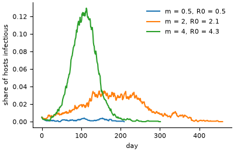
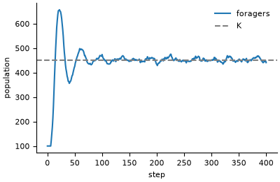
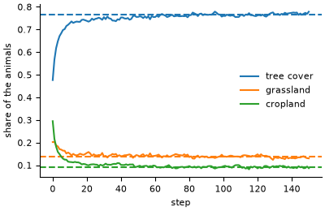
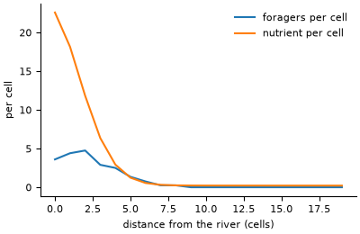
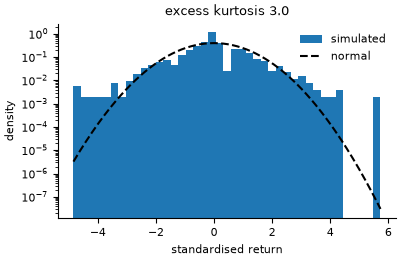
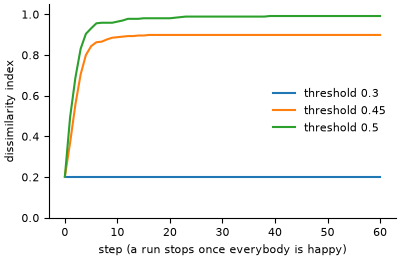
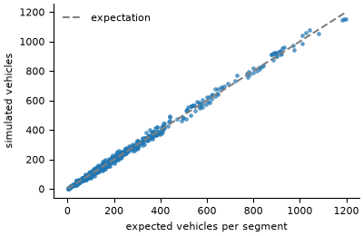

# Gallery

A figure from every model of the [zoo](zoo/index.md), each made by running the model with a
fixed seed. The figures are drawn by `tools/gallery/make_figures.py`, one panel per model in
`tools/gallery/panels/`; rerun it (`python tools/gallery/make_figures.py`, the same in bash
and PowerShell) after changing a model.

## Epidemiology

**[Age-structured SEIR](zoo/age_seir.md).** Children, with the most contacts, peak first and
highest.


**[Vector-borne transmission](zoo/vector_borne.md).** Outbreaks grow with mosquito density,
in the order of the Ross-Macdonald R0.



**[Epidemic and hospital capacity](zoo/hospital_epidemic.md).** When contacts fall with the
pressure on the hospital, occupancy peaks lower and later, and fewer surge beds open.


## Ecology

**[Forest fire](zoo/forest_fire.md).** The burnt share jumps at the percolation threshold.


**[Energy budgets](zoo/energy_budget.md).** After a boom and bust the population settles on
the carrying capacity set by the energy balance.



**[Habitat selection](zoo/habitat_selection.md).** On real land cover, animals started
uniformly settle in proportion to habitat preference (dashed: the stationary law).



**[Foragers on a nutrient field](zoo/nutrient_foragers.md).** The nutrient diffuses inland from
the river bank, and the foragers follow it.



## Economics

**[Order book](zoo/order_book.md).** Mid-price returns have fat tails compared with a
normal distribution.



**[Boltzmann wealth exchange](zoo/kinetic_wealth.md).** Random exchange of money gives the
Boltzmann-Gibbs distribution.


**[Bouchaud-Mezard](zoo/bouchaud_mezard.md).** The Gini settles on the value of the
inverse-gamma law, higher for noisier returns.


## Sociology and political science

**[Deffuant](zoo/deffuant.md).** Opinions merge into a few clusters.


**[Hegselmann-Krause](zoo/hegselmann_krause.md).** Final opinions against the confidence
bound: many clusters, fewer, then consensus.


**[Schelling on real neighbourhoods](zoo/schelling_regions.md).** On census tracts, households
content to be a slight minority still end almost fully segregated.



**[Axelrod](zoo/axelrod.md).** More traits per feature leave more cultural regions.


## Transport and energy

**[Nagel-Schreckenberg](zoo/nagel_schreckenberg.md).** The fundamental diagram, with and
without random braking.


**[Traffic assignment](zoo/road_traffic.md).** On real streets, every segment's flow follows
its edge betweenness.



**[Bass diffusion](zoo/bass_diffusion.md).** Adoption follows the Bass curve when mixing is
complete, and lags on a sparse network.


## Submit your model

The gallery is also open to community models built with Modelly that are not in the zoo.
Open a pull request that adds your model's entry to this page under a section
"Community models", with one PNG of at most 100 KB in `docs/images/gallery/community/`, and
fill in the template below in the pull request description. A gallery entry does not need
a validation test, but it must run from a seed and say how it was checked.

```text
Title:            one line
Author(s):        names, and an ORCID if you have one
Field:            epidemiology / ecology / economics / sociology / transport / energy / other
Repository:       a public URL with the code, a licence and a README
Modelly version:  the version it was run with (python -c "import modelly; print(modelly.__version__)")
Reference:        the paper or report it reproduces or supports, if any
What it shows:    two or three sentences
How to run it:    the command that makes the figure, with its seed
How it was checked: an analytical result, a published figure, a comparison with another
                    implementation, or a test in the repository
Runtime:          on a laptop, for the figure
```

The maintainers run the command before merging. Models that are validated, small and of
general interest may be invited into the zoo.
