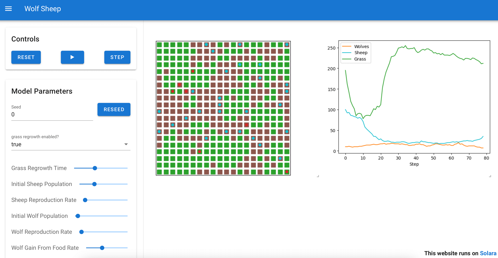

---
myst:
  html_meta:
    description: "Modelly is an agent-based modeling (ABM) framework for Python: typed scenarios, seeded reproducible runs, numpy-backed agents, grids, networks, continuous space, discrete-event time, pandas data collection and browser visualization."
    keywords: "agent-based modeling, ABM, agent-based simulation, Python, multi-agent systems, complex systems, discrete-event simulation, Mesa alternative"
    "og:title": "Modelly: agent-based modeling in Python"
    "og:description": "Build, run, measure and replay agent-based models in Python. Fast by construction, reproducible by default."
    "og:type": "website"
---

# Modelly: agent-based modeling in Python

**Modelly** is an [Apache-2.0](https://github.com/RemiPelloux/Modelly/blob/main/LICENSE) licensed
framework for **agent-based modeling (ABM)** in Python. You declare a scenario, give your agents
behaviour, run the world forward in time, then measure, replay and publish the result.

It is built for research: every run is seeded, every parameter lives in a typed scenario, every
dataset lands in pandas, and the hot paths of a simulation are measured and benchmarked in CI.

```bash
pip install modelly-abm          # the distribution on PyPI; the import name is modelly
```

```python
from modelly import Model
from modelly.discrete_space import CellAgent, OrthogonalMooreGrid
from modelly.experimental.scenarios import Scenario


class WealthScenario(Scenario):
    n: int = 120
    width: int = 12
    height: int = 12


class MoneyAgent(CellAgent):
    def __init__(self, model, cell):
        super().__init__(model)
        self.cell = cell
        self.wealth = 1

    def step(self):
        self.cell = self.cell.neighborhood.select_random_cell()
        cellmates = [a for a in self.cell.agents if a is not self]
        if self.wealth > 0 and cellmates:
            self.random.choice(cellmates).wealth += 1
            self.wealth -= 1


class WealthModel(Model):
    def __init__(self, scenario: WealthScenario = WealthScenario):
        super().__init__(scenario=scenario)
        self.grid = OrthogonalMooreGrid(
            (scenario.width, scenario.height), random=self.random
        )
        cells = self.random.choices(self.grid.all_cells.cells, k=scenario.n)
        MoneyAgent.create_agents(self, scenario.n, cells)

    def step(self):
        self.agents.shuffle_do("step")


model = WealthModel()
for _ in range(100):
    model.step()
```

Three pieces: a **scenario** of inputs, **agents** that each know one thing, and a **model** that
owns the world and advances it.



## What you get

| Building block | What it gives you |
|---|---|
| **Scenario** | Parameters as a typed class: one run, one seed, one config object |
| **Agents** | Agent classes with a `step()`, grouped in ordered `AgentSet`s |
| **Columns** | Attributes stored in numpy arrays, readable per agent and as a whole |
| **Space** | Orthogonal and hexagonal grids, cells, networks, Voronoi meshes, continuous space |
| **Time** | Discrete ticks, scheduled events, generators and priorities in one scheduler |
| **Data** | Reporters and datasets that land in pandas, ready to plot |
| **Visualization** | Browser dashboards (Solara), static charts (matplotlib, altair), notebooks |
| **Replications** | Seeded parameter sweeps spread over processes |

## Where to go next

- [Getting started](getting_started): the concepts, then twelve executable tutorials from *your
  first model* to *hybrid ABM / discrete-event simulation*.
- [Use Modelly in your project](using_modelly_in_your_project): from an empty folder to a tested,
  replicated model.
- [Examples](examples): Boltzmann wealth, Schelling, Game of Life, SIR on a network, Boids,
  Wolf-Sheep, Sugarscape, Epstein civil violence and more, all runnable.
- [Migrating from Mesa](migrating_from_mesa): a construct-by-construct map and the
  `python -m modelly.migrate` codemod.
- [Performance](performance): how the engine stays fast, with the measurements.
- [Vectorised step phases](vectorised_phases): when a loop over agents is an array
  operation, with the equivalence arguments the benchmark playbooks check.
- [Best practices](best-practices) and the [API reference](apis/api_main).

## Community and source

- [GitHub repository](https://github.com/RemiPelloux/Modelly): source, issues and pull requests.
- [Discussions](https://github.com/RemiPelloux/Modelly/discussions): questions and ideas.
- [Changelog](https://github.com/RemiPelloux/Modelly/blob/main/CHANGELOG.md): what each release
  added, changed and fixed.
- [Contributing guide](https://github.com/RemiPelloux/Modelly/blob/main/CONTRIBUTING.md): local
  setup, tests, lint, docs and how a pull request is reviewed.

## Citing Modelly

If Modelly contributes to a publication, cite it with the metadata in
[CITATION.cff](https://github.com/RemiPelloux/Modelly/blob/main/CITATION.cff). GitHub's
"Cite this repository" button formats it as APA or BibTeX.

```{toctree}
:hidden: true
:maxdepth: 2

Getting started <getting_started>
Use Modelly in your project <using_modelly_in_your_project>
Examples <examples>
Migrating from Mesa <migrating_from_mesa>
Performance <performance>
Vectorised step phases <vectorised_phases>
Best practices <best-practices>
Overview <overview>
API reference <apis/api_main>
```

## Indices

- {ref}`genindex`
- {ref}`modindex`
- {ref}`search`
