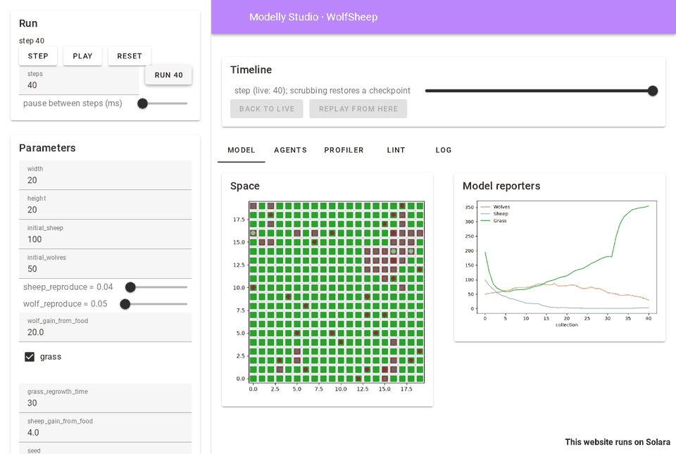
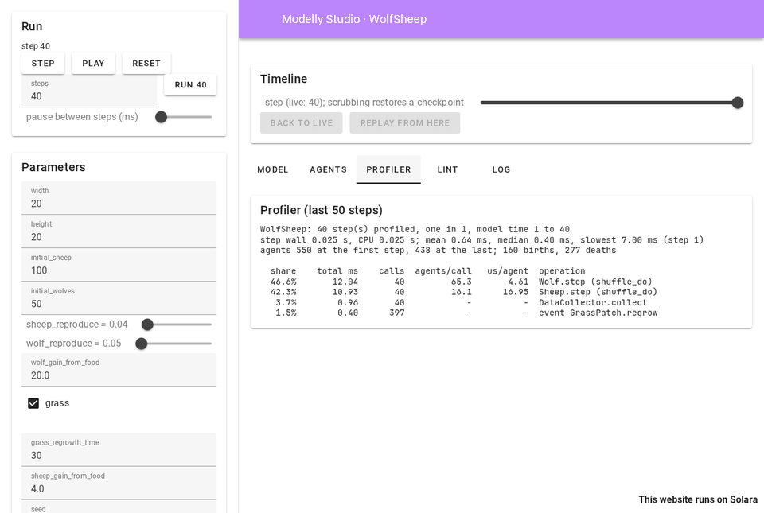
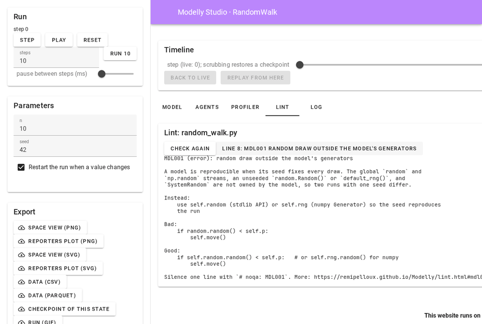
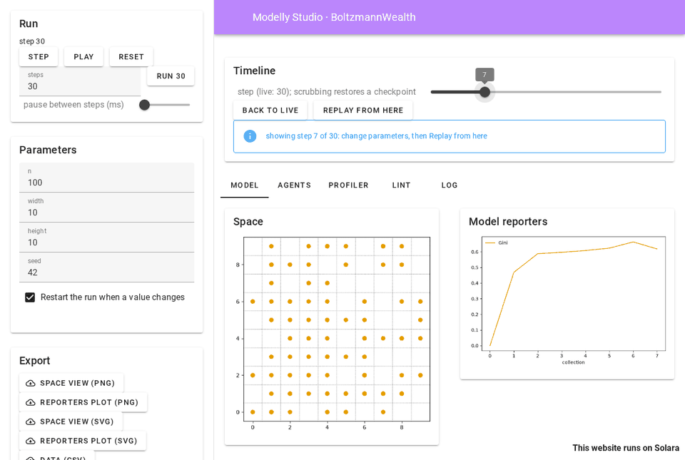

# Modelly Studio

Modelly Studio is a browser app for one model: run it, change its parameters, scrub back
through the run, and see the space, the plots, the agents, the profiler and the linter side by
side. It works with any Modelly model, with no code to write: the parameter panel comes from the
model's `Scenario`, the space view from the same drawing code `SolaraViz` uses.

```bash
pip install "modelly-abm[viz]"
modelly studio path/to/model.py:MyModel
```

The command serves the app on `http://127.0.0.1:8765` and opens it in the default browser, on
Windows, macOS and Linux alike. Stop it with Ctrl+C.



## Starting Studio

```bash
modelly studio modelly/examples/advanced/wolf_sheep/model.py:WolfSheep
modelly studio modelly.examples.advanced.wolf_sheep.model:WolfSheep --seed 7
modelly studio model.py:Epidemic --port 8800 --no-browser
modelly studio model.py:Epidemic --portrayal app.py:agent_portrayal
python -m modelly.studio model.py:Epidemic          # the same, without the umbrella command
```

The target is a file and a class, or a dotted module and a class, as for
[`modelly profile`](profile.md). A file inside a package (folders with `__init__.py`) is
imported under its package name, so checkpoints of the model load again later; a loose file is
imported under its own name with its folder on `sys.path`, so `from agents import Sheep` next
to it works.

| Option | Meaning |
|---|---|
| `--port N` | port to serve on (default 8765); `0` picks a free one |
| `--host ADDRESS` | address to listen on (default `127.0.0.1`, this computer only) |
| `--no-browser` | do not open the default browser |
| `--seed N` | seed of the first run (default 42) |
| `--portrayal FILE.py:FUNCTION` | how agents are drawn: a function returning an `AgentPortrayalStyle` |
| `--every N` | steps between two timeline checkpoints (default 1) |
| `--profile-steps N` | how many of the last steps the profiler panel sums (default 50) |
| `--memory-budget MIB` | mebibytes the timeline's checkpoints may take (default 256) |

Exit status: 0 when the server stopped normally, 1 when the model raised while being built, 2
for a bad command line or a target that cannot be found. The model is built once before the
server starts, so these errors show in the terminal.

The bundled examples' `app.py` files define portrayals Studio can reuse, for example
`--portrayal modelly/examples/advanced/wolf_sheep/app.py:wolf_sheep_portrayal`. Without one,
each agent class gets its own colour from the colour-blind-safe Okabe-Ito palette.

## The panels

**Run** (sidebar): Step, Run N steps, Play and Pause, Reset, and the pause between two steps
while playing. Play waits for each step to be drawn before taking the next one. An exception
raised by the model stops the run and shows under the buttons; the traceback is in the log.

**Parameters** (sidebar): one input per field of the model's `Scenario`, and per keyword
argument with a default of its constructor:

| Field | Input |
|---|---|
| `bool` | checkbox |
| `Literal[...]` or an `Enum` | select |
| `float` between 0 and 1 | slider |
| other `int` and `float` | number field |
| `str` | text field |
| anything else (tuple, dict, None) | shown, not editable |

and the seed. With "Restart the run when a value changes" (on by default) a change rebuilds the
model at step 0; turn it off to keep the change for Reset, or for Replay from here.

**Timeline**: a slider over every step of the run so far. Moving it shows the model at that step
in every view, the live run going on untouched; Back to live returns to the latest step.

**Model**: the space (orthogonal and hexagonal grids, networks, continuous space and Voronoi
grids, drawn by `SpaceRenderer`) and a plot of the `DataCollector`'s numeric model reporters.
A model without a space or a collector says so instead.

**Agents**: the first 100 agents by `unique_id`, one column per attribute (the values
`modelly.timetravel.agent_state` reads: plain attributes, columns and the cell or position),
filtered by class.

**Profiler**: [`modelly profile`](profile.md) over the last 50 steps: the costliest operations,
microseconds per agent and the hints. Every step Studio takes is profiled; one session profiles
at a time, since the profiler patches classes for the whole process.



**Lint**: [`modelly lint`](lint.md) on the model's file. Each finding is a button; clicking it
shows the rule's `--explain` text. Check again re-reads the file after you edit it.



**Log**: what happened in the run: new runs and their values, replays, errors, and why a model
could not be checkpointed.

**Export** (sidebar): the space view and the reporters plot as PNG or SVG, the collected model
data as CSV (and Parquet when `pyarrow` is installed), a checkpoint of the state shown (load it
with `Model.load`), and a GIF of the run's space view (at most 120 frames, sampled evenly).

## Scrubbing and replaying



Studio records each run with a [`modelly.timetravel.Recorder`](timetravel.md), one checkpoint
per step by default (`--every`). Scrubbing restores the checkpoint at or before the step and
replays on to it, so the state shown is the one the run had at that step, bit for bit.

To try another future from a step: scrub to it, change parameters (with "Restart the run" off),
and click Replay from here. The scrubbed-to state becomes the live run, with the changed
Scenario values set on its scenario and, when the seed changed, both generators reseeded. What
[the time travel guide](timetravel.md#replay-with-a-changed-scenario) says holds: code that
reads `self.scenario.<name>` sees the new value from the next step on, but values the model
copied out of the scenario when it was built keep their old ones, and constructor arguments
(not on the scenario) are not applied, which the log says.

### Models that cannot be checkpointed

A model that holds a lambda (a `DataCollector` reporter, say), a generator or a class made at
run time cannot be pickled, so it cannot be checkpointed. Studio then replays instead: scrubbing
rebuilds the run from its start with the same parameters and seed and runs it on to the step.
Seeded runs are reproducible, so the state is the same; it only takes longer on long runs. The
log names what could not be saved, and the timeline says "scrubbing replays the run". Of the
bundled examples, Epstein civil violence, the prisoner's dilemma grid, Sugarscape, the tram
model and alliance formation replay; the others restore checkpoints. Making their reporters
module-level functions (see [checkpoints](checkpoints.md)) makes scrubbing instant.

## Platforms and network

Studio is a Solara app served by uvicorn on your computer and drawn in your browser: there is
nothing OS-specific in it, and paths are handled with `pathlib`. By default it listens on
`127.0.0.1` only, so nothing outside your computer can reach it; `--host 0.0.0.0` shares it on
your network, with no authentication, so use that on a network you trust only.

Studio's own code makes no network request, and Solara's telemetry is turned off. Solara
fetches a few of its own front-end files (fonts, RequireJS) from its CDN the first time they are
needed and caches them under `share/solara/cdn` in the environment; on a machine without
internet access, install the `solara-assets` package once so they are served locally.

## Architecture

Studio is a [Solara](https://solara.dev) app, decided for 1.3 over a separate front end: it
reuses the visualisation code of `modelly.viz` (the portrayal styles, `SpaceRenderer` and its
Matplotlib backend) rather than duplicating it in JavaScript, runs on Windows, macOS and Linux
with nothing to build, and keeps the model in the same Python process as the panels, so the
profiler, the linter and the recorder see the real objects.

| Module | Role |
|---|---|
| `modelly.studio.session` | `StudioSession`: one tab's run, with no widget (the tests drive it directly) |
| `modelly.studio.timeline` | the checkpoint recorder, or the replay timeline |
| `modelly.studio.params` | the parameter panel's fields, from the `Scenario` |
| `modelly.studio.data` | series, agent table, figures and export files |
| `modelly.studio.app` | `StudioApp(session)` and `Page`, the page the server shows |

Each browser tab gets its own session. `StudioApp(session)` renders headless with
`solara.render`, which is how the test suite opens every bundled example in Studio.

The screenshots on this page were taken headless, with Playwright driving Chromium against
`modelly studio`.

The API is in [Studio](apis/studio.md).
