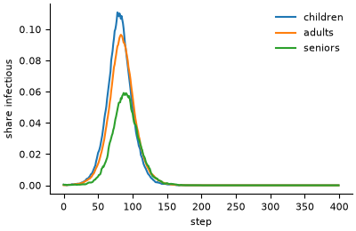

# Age-structured SEIR with contact matrices

**Field:** epidemiology · **Zoo name:** `age_seir` · **Module:** `modelly.zoo.age_seir.model`



People are split into age groups and are susceptible, exposed, infectious or recovered. A
susceptible of group `a` is infected in one step with probability
`1 - exp(-beta * sum_b C[a, b] * I_b / N_b)`, where `C[a, b]` is the mean number of contacts
a member of `a` has with members of `b` per step. Exposed people become infectious with
probability `incubation` per step, infectious people recover with probability `recovery`.

## How it is written

Everybody in the same group and state faces the same probabilities, so the population is a
`CohortTable` with one row per (group, state), and each transition is one binomial draw per
row. That has exactly the law of one draw per person (see
[Vectorised step phases](../vectorised_phases.md)), and a population of a million costs the
same as one of a hundred. A contact matrix measured on a synthetic population comes from
`modelly.space.networks.contact_matrix`; see [Networks](../networks.md).

```python
from modelly.zoo.age_seir.model import AgeSEIR, SEIRScenario

model = AgeSEIR(SEIRScenario(rng=42))
model.run()
model.r0(), model.attack_rate(), model.final_size()
model.datacollector.get_model_vars_dataframe()  # S, E, I, R per step
```

| Parameter | Default | Meaning |
|---|---|---|
| `group_sizes` | `(20000, 60000, 20000)` | people per age group (children, adults, seniors) |
| `contacts` | 3 x 3, reciprocal | `C[a][b]`, contacts per step of a member of `a` with members of `b` |
| `beta` | `0.035` | transmission probability per contact |
| `incubation` | `0.25` | probability per step that an exposed person becomes infectious |
| `recovery` | `0.2` | probability per step that an infectious person recovers |
| `initial_infected` | `(10, 10, 10)` | infectious people per group at the start |
| `steps` | `400` | run length of `run()` |

The default contact matrix is illustrative, not survey data.

To start from a synthetic population (people in households, schools and workplaces, built from
census tables with `modelly.population`), `scenario_from_population` counts the age groups and
measures the contact matrix on the population's contact network; see
[Synthetic populations](../population.md#starting-the-age-structured-seir-model). The default
scenario does not change.

```python
from modelly.population import contact_network
from modelly.zoo.age_seir.model import AgeSEIR, scenario_from_population

network = contact_network(people, model.rng)
seir = AgeSEIR(
    scenario_from_population(people, network, ("0-17", "18-64", "65+"), rng=5)
)
```

## Validation

Summing the force of infection over the whole epidemic gives the final-size relation
`log(s_a) = log(s0_a) - (beta / recovery) * sum_b C[a, b] * (1 - s_b)`, where `s_a` is the
share of group `a` never infected. With one group it is the Kermack-McKendrick relation
`s = s0 * exp(-R0 * (1 - s))`, with `R0 = beta * C / recovery`. `final_size()` solves it.

`tests/zoo/test_age_seir.py` runs a homogeneous population of 200,000, written both as one
group and as three equal groups, with three seeds, and checks the simulated attack rate is
within five standard deviations of the final-size relation, the standard deviation coming
from the central limit theorem for the final size (Andersson and Britton). It also checks the
three age groups against the multi-group relation, that an outbreak with `R0 < 1` stays small,
that nobody is created or lost, and that the same seed gives the same epidemic curve.

## References

- Kermack, W. O. and McKendrick, A. G. (1927). A contribution to the mathematical theory of
  epidemics. *Proceedings of the Royal Society A*, 115, 700-721.
- Mossong, J. et al. (2008). Social contacts and mixing patterns relevant to the spread of
  infectious diseases. *PLoS Medicine*, 5(3), e74.
- Andersson, H. and Britton, T. (2000). *Stochastic Epidemic Models and Their Statistical
  Analysis*. Lecture Notes in Statistics 151, Springer.

Start a project from it with `modelly zoo copy age_seir my_epidemic`.
