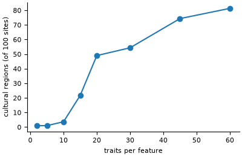

# Axelrod culture dissemination

**Field:** political science · **Zoo name:** `axelrod` · **Module:** `modelly.zoo.axelrod.model`



Every site of a square grid holds a culture: `features` features, each one of `traits`
values. At each event a random site and a random neighbour interact with probability equal to
their overlap, the share of features on which they agree; when they do, the site copies one
feature on which they differ. Similar neighbours grow more similar and neighbours with nothing
in common never interact, so the grid freezes into regions of identical culture: one culture
for few traits, many regions for many traits.

## How it is written

The sites are the rows of a `CellIndex` over an `OrthogonalVonNeumannGrid`, and the cultures
one `(n_sites, features)` integer array. Events stay sequential, as in the original, but each
step draws its sites, their neighbours (`CellIndex.random_neighbor`) and the uniforms in
three numpy calls, then runs `events_per_step` events on plain lists. After each step the
model checks every bond at once; when no pair with partial overlap is left the map is frozen
and `running` turns `False`. Regions are the connected components of the bonds with full
overlap (`scipy.sparse.csgraph`).

```python
from modelly.zoo.axelrod.model import Axelrod, AxelrodScenario

model = Axelrod(AxelrodScenario(rng=42, traits=15))
model.run()
model.n_regions(), model.time
```

| Parameter | Default | Meaning |
|---|---|---|
| `width`, `height` | `10`, `10` | grid size in sites |
| `features` | `5` | cultural features per site |
| `traits` | `10` | values each feature can take |
| `events_per_step` | `2000` | interactions attempted per step |
| `steps` | `500` | maximum run length of `run()` |

## Validation

`tests/zoo/test_axelrod.py` runs the 10 x 10, five-feature model of the original paper to its
absorbing state with five seeds. Two traits end in a single region for at least four seeds of
five; thirty traits leave more than 25 regions in every run; the mean number of regions grows
from two to fifteen to sixty traits. It also checks the absorbing state (every bond has
overlap 0 or `features`), the interaction rule on hand-made pairs, and that the same seed
gives the same culture map.

## References

- Axelrod, R. (1997). The dissemination of culture: a model with local convergence and
  global polarization. *Journal of Conflict Resolution*, 41(2), 203-226.
- Castellano, C., Marsili, M. and Vespignani, A. (2000). Nonequilibrium phase transition in a
  model for social influence. *Physical Review Letters*, 85(16), 3536-3539.

Start a project from it with `modelly zoo copy axelrod my_cultures`.
