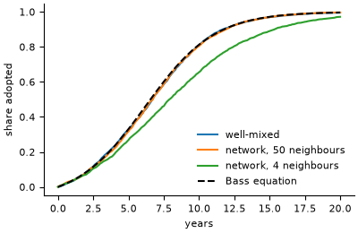

# Bass diffusion of innovation on a network

**Field:** energy · **Zoo name:** `bass_diffusion` · **Module:** `modelly.zoo.bass_diffusion.model`



Households adopt an innovation, rooftop solar panels for instance. In each step of length
`dt` years a household that has not adopted does so with probability
`(innovation + imitation * share) * dt`, where `innovation` (Bass's `p`) is the pull of
advertising and `imitation` (Bass's `q`) the pull of the households it knows. `share` is the
share of adopters among everybody (`mixing="well-mixed"`, Bass's original model) or among the
household's neighbours in a random network of mean degree `degree` (`mixing="network"`).

## How it is written

Households are `Household` agents with an `adopted` `Column`; a step is one
`ColumnTable.draw` for the whole population. The network is a one-layer
`MultilayerNetwork` (see [Networks](../networks.md)), so the share of adopting neighbours
of every household is one sparse product, `adjacency() @ adopted`, divided by the degrees.

```python
from modelly.zoo.bass_diffusion.model import BassDiffusion, BassScenario, bass_curve

model = BassDiffusion(BassScenario(rng=42, mixing="network", degree=8))
model.run()
frame = model.datacollector.get_model_vars_dataframe()  # time (years), adoption share
bass_curve(frame["time"], 0.03, 0.38)  # the well-mixed Bass solution
```

| Parameter | Default | Meaning |
|---|---|---|
| `households` | `5000` | number of households |
| `innovation` | `0.03` | Bass `p`, adoption rate per year from outside influence |
| `imitation` | `0.38` | Bass `q`, adoption rate per year when every neighbour has adopted |
| `dt` | `0.1` | step length, years |
| `mixing` | `"well-mixed"` | `"well-mixed"` or `"network"` |
| `degree` | `10.0` | mean number of neighbours in the random network |
| `steps` | `200` | run length of `run()` |

## Validation

In the well-mixed limit the expected adoption share follows the Bass equation
`dF/dt = (p + q F)(1 - F)`, solved by
`F(t) = (1 - exp(-(p + q) t)) / (1 + (q / p) exp(-(p + q) t))` (`bass_curve`).
`tests/zoo/test_bass_diffusion.py` checks, with three seeds, that the simulated share is within
the Euler discretisation error (the step recursion against the exact solution) plus five
standard deviations of the ODE at every step. The standard deviation comes from the linear
noise approximation: each step adds binomial noise of variance `(1 - F) h (1 - h) / N`, with
`h = (p + q F) dt`, and a deviation grows by `1 + f'(F)` per step. It also checks that a dense
network (50 neighbours) stays within the same bound, that a sparse one (4 neighbours) lags the
well-mixed curve at mid-diffusion, because non-adopters cluster together, and that the same
seed gives the same curve.

## References

- Bass, F. M. (1969). A new product growth for model consumer durables. *Management
  Science*, 15(5), 215-227.

Start a project from it with `modelly zoo copy bass_diffusion my_diffusion`.
