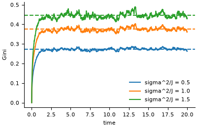

# Bouchaud-Mezard wealth condensation

**Field:** economics · **Zoo name:** `bouchaud_mezard` · **Module:** `modelly.zoo.bouchaud_mezard.model`



Each agent earns a random return on its wealth and exchanges with everybody else. In the
mean-field version, `dW_i = J (mean(W) - W_i) dt + sigma W_i dB_i` (Ito): returns of
variance `sigma^2` per unit time, and an exchange that pulls each wealth toward the mean at
rate `J`. The more noise relative to exchange, the more the wealth condenses into a few hands.

## How it is written

Wealth is a `Column` on the `Saver` agent class. A step of length `dt` applies the
multiplicative part exactly, `W <- W exp(sigma sqrt(dt) xi - sigma^2 dt / 2)` (mean
preserving, never negative), then the exchange `W <- W + J dt (mean(W) - W)`, then divides by
the mean, so `model.wealth` is wealth relative to the mean. Each part is one numpy expression
over the column.

```python
from modelly.zoo.bouchaud_mezard.model import BouchaudMezard, BouchaudMezardScenario

model = BouchaudMezard(BouchaudMezardScenario(rng=42, volatility=1.0))
model.run()
model.stationary_shape()  # alpha = 1 + 2 J / sigma^2
model.datacollector.get_model_vars_dataframe()  # Gini per step
```

| Parameter | Default | Meaning |
|---|---|---|
| `n` | `2000` | number of agents |
| `exchange` | `1.0` | exchange rate `J` per unit time |
| `volatility` | `1.0` | `sigma`, standard deviation of returns per unit time |
| `dt` | `0.01` | step length; `exchange * dt` must be below one |
| `steps` | `2000` | run length of `run()` |

## Validation

The Fokker-Planck equation of the relative wealth `w` has the stationary density
`P(w) ~ exp(-(alpha - 1) / w) / w^(1 + alpha)`: an inverse-gamma law with shape
`alpha = 1 + 2 J / sigma^2` and mean one, whose tail is a Pareto law of exponent `alpha`.
Bouchaud and Mezard write the noise variance as `2 sigma^2`, hence their
`mu = 1 + J / sigma^2`.

`tests/zoo/test_bouchaud_mezard.py` runs 2,000 agents for ten relaxation times, then takes
twenty spaced snapshots, for `sigma^2 / J` = 0.5, 1 and 1.5 (shapes 5, 3 and 7/3, all of
finite variance) and two seeds. The mean Gini must be within three single-snapshot standard
deviations of the Gini of the inverse-gamma law, computed by quadrature of its Lorenz
identity `G = 1 - int (1 - F)^2`. Both the analytic and the simulated Gini must rise with
`sigma^2 / J`. It also checks that an unstable step length is rejected and that the same
seed gives the same run.

## References

- Bouchaud, J.-P. and Mezard, M. (2000). Wealth condensation in a simple model of economy.
  *Physica A*, 282, 536-545.

Start a project from it with `modelly zoo copy bouchaud_mezard my_economy`.
