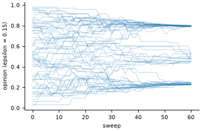

# Deffuant bounded-confidence opinion dynamics

**Field:** sociology · **Zoo name:** `deffuant` · **Module:** `modelly.zoo.deffuant.model`



Every agent holds an opinion in `[0, 1]`. Two agents who meet compromise only when their
opinions differ by less than the confidence bound `epsilon`: each moves a share `mu` of the
difference towards the other. A wide bound ends in consensus; a narrow one freezes the
population into clusters, about `floor(1 / (2 epsilon))` of them for uniform initial opinions.

## How it is written

Opinions are a `Column` of the `Voter` agents, so the whole population is one numpy array.
The original model meets one random pair per time step; here one step is a sweep: a uniformly
random perfect matching (a permutation cut into consecutive pairs), and every pair closer than
`epsilon` compromises at once from the start-of-step opinions. The pairs are disjoint, so the
updates never interfere, and each agent meets one uniformly random partner per step. A step
is therefore about `n / 2` events of the original model, with the same absorbing states:
clusters further than `epsilon` apart.

```python
from modelly.zoo.deffuant.model import Deffuant, DeffuantScenario

model = Deffuant(DeffuantScenario(rng=42, epsilon=0.1))
model.run()
model.n_clusters()
model.datacollector.get_model_vars_dataframe()  # clusters and spread per step
```

| Parameter | Default | Meaning |
|---|---|---|
| `n` | `500` | number of agents |
| `epsilon` | `0.2` | confidence bound |
| `mu` | `0.5` | share of the difference each partner moves |
| `min_cluster_share` | `0.02` | clusters smaller than this share are not counted |
| `steps` | `300` | run length of `run()`, in sweeps |

## Validation

`tests/zoo/test_deffuant.py` checks, with three seeds, that `epsilon = 0.4` ends in one
cluster, that `epsilon = 0.1` leaves `floor(1 / (2 epsilon)) = 5` clusters plus or minus two
(run-to-run fluctuations of the published rule of thumb), and that the mean cluster count does
not grow over the sweep `epsilon = 0.05, 0.1, 0.2, 0.4`. It also checks that the mean opinion
is conserved by every compromise, that `epsilon = 0` freezes the opinions, and that the same
seed gives the same run.

## References

- Deffuant, G., Neau, D., Amblard, F. and Weisbuch, G. (2000). Mixing beliefs among
  interacting agents. *Advances in Complex Systems*, 3, 87-98.

Start a project from it with `modelly zoo copy deffuant my_opinions`.
