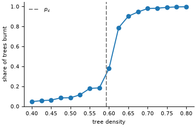

# Forest fire and succession on a raster

**Field:** ecology · **Zoo name:** `forest_fire` · **Module:** `modelly.zoo.forest_fire.model`



A raster of cells, each empty, a tree, burning or burnt. At the start every cell holds a tree
with probability `density`, or with its own probability from a `cover` raster, and the trees
of the west edge are set alight. Every step a tree next to a burning cell (von Neumann
neighbourhood) catches fire and a burning cell burns out. With `growth > 0` empty and burnt
cells grow a tree with that probability per step, and with `lightning > 0` a tree is struck
with that probability per step: the Drossel-Schwabl model of succession and disturbance.

## How it is written

The state is one integer per cell, kept as a property layer of an `OrthogonalVonNeumannGrid`
(`model.layer`, shaped `(width, height)` like the grid; `model.state` is the same array
flattened in `CellIndex` row order). The spread is one sparse product per step,
`CellIndex.neighbor_sum`, over the grid's adjacency, so a 100 x 100 fire runs in a fraction of
a second. A land-cover raster read with `modelly.space.geo.RasterLayer` gives the cover
directly: `ForestScenario(cover=layer.values)` (the geo extra is needed only for reading the
file, not for the model).

```python
from modelly.zoo.forest_fire.model import ForestFire, ForestScenario

model = ForestFire(ForestScenario(rng=42, density=0.65))
model.run()  # stops when the fire is out
model.burnt_share(), model.spans()
model.datacollector.get_model_vars_dataframe()  # cells per state per step
```

| Parameter | Default | Meaning |
|---|---|---|
| `width`, `height` | `100`, `100` | raster size in cells |
| `density` | `0.6` | probability that a cell starts with a tree |
| `cover` | `None` | per-cell tree probability, shape `(width, height)`, replaces `density` |
| `growth` | `0.0` | probability per step that an empty or burnt cell grows a tree |
| `lightning` | `0.0` | probability per step that a tree is struck |
| `steps` | `2000` | maximum run length of `run()` |

## Validation

Without growth and lightning the fire burns exactly the clusters of trees connected to the
west edge, so the model is site percolation on the square lattice, whose threshold is
`p_c = 0.592746` (Newman and Ziff). On a 100 x 100 raster the transition is about
`L^(-3/4) ~ 0.03` wide.

`tests/zoo/test_forest_fire.py` checks, for three seeds, that at `p_c - 0.15` the fire never
reaches the east edge and burns under 10 % of the trees, and that at `p_c + 0.15` it always
reaches the east edge and burns over 90 %; that the mean burnt share rises with density; that
a cover raster confines the trees; that succession mode keeps burning and conserves cells; and
that the same seed gives the same fire.

## References

- Drossel, B. and Schwabl, F. (1992). Self-organized critical forest-fire model. *Physical
  Review Letters*, 69(11), 1629-1632.
- Newman, M. E. J. and Ziff, R. M. (2000). Efficient Monte Carlo algorithm and high-precision
  results for percolation. *Physical Review Letters*, 85(19), 4104-4107.
- Stauffer, D. and Aharony, A. (1994). *Introduction to Percolation Theory*, 2nd ed. Taylor
  and Francis.

Start a project from it with `modelly zoo copy forest_fire my_forest`.
