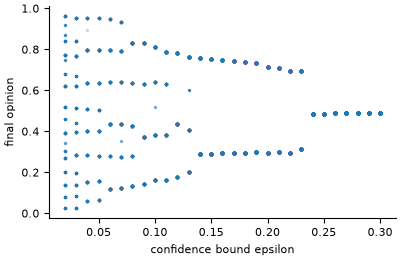

# Hegselmann-Krause bounded-confidence opinion dynamics

**Field:** sociology · **Zoo name:** `hegselmann_krause` ·
**Module:** `modelly.zoo.hegselmann_krause.model`



Every agent holds an opinion in `[0, 1]`. At each step, all at once, every agent moves to the
mean opinion of the agents within `epsilon` of its own, itself included. Agents further apart
never influence each other, so the population splits into clusters that stop moving after a
finite number of steps; a wide bound ends in consensus.

## How it is written

Opinions are a `Column` of the `Voter` agents. The confidence set of an agent is a contiguous
range of the sorted opinions: two `searchsorted` calls find its ends and a running sum gives
its mean, so a step costs `O(n log n)` instead of the `O(n^2)` of comparing every pair
(`confidence_means`). The run stops, with `running` set to `False`, as soon as no opinion
moves by more than `tolerance`.

```python
from modelly.zoo.hegselmann_krause.model import HegselmannKrause, HKScenario

model = HegselmannKrause(HKScenario(rng=42, epsilon=0.1))
model.run()
model.n_clusters(), model.time  # clusters, and the step at which they froze
```

| Parameter | Default | Meaning |
|---|---|---|
| `n` | `300` | number of agents |
| `epsilon` | `0.15` | confidence bound |
| `tolerance` | `1e-9` | the run stops when no opinion moves more than this |
| `min_cluster_share` | `0.02` | clusters smaller than this share are not counted |
| `steps` | `100` | maximum run length of `run()` |

## Validation

`tests/zoo/test_hegselmann_krause.py` checks, with three seeds, that `epsilon = 0.3` settles
into consensus, that `epsilon = 0.05` and `0.1` leave more than two and at most
`1 / (2 epsilon)` clusters, and that the mean cluster count falls to one over the sweep
`0.05, 0.1, 0.2, 0.3`. The fast step is compared with the plain `O(n^2)` definition on 200
agents over five steps, to within rounding (`1e-12`). A zero bound stops the run after one
step, and the same seed gives the same run.

## References

- Hegselmann, R. and Krause, U. (2002). Opinion dynamics and bounded confidence: models,
  analysis and simulation. *Journal of Artificial Societies and Social Simulation*, 5(3).

Start a project from it with `modelly zoo copy hegselmann_krause my_opinions`.
