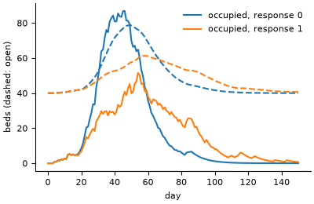

# Epidemic coupled to hospital capacity

**Field:** epidemiology · **Zoo name:** `hospital_epidemic` · **Module:** `modelly.zoo.hospital_epidemic.model`



People are agents, each susceptible, infectious or recovered, mixing homogeneously. A
susceptible is infected in a step with probability `1 - exp(-beta_eff * I / N)`, an infectious
person recovers with probability `recovery` per step, and a share `severe` of the new
infections need a hospital bed. The hospital is a system-dynamics model: occupied beds fill
with the admissions and empty at rate `occupied / stay`; open beds move towards
`base_beds + surge * occupied` with time constant `ramp`, as a hospital opens surge wards.
People respond to the pressure on the hospital: their contacts fall with the share of beds
occupied, `beta_eff = beta / (1 + response * occupied / beds)`.

## How it is written

People are `Person` agents with a `Column` for their state, so a step is a few numpy
operations on the whole population. The hospital is a [`StockFlow`](../coupling.md) with two
stocks and three flows, integrated with scipy's `solve_ivp` (Dormand-Prince, `rtol=1e-8`):

| Flow | From | To | Rate |
|---|---|---|---|
| `admit` | outside | `occupied` | the admissions of the agents' step |
| `discharge` | `occupied` | outside | `occupied / stay` |
| `open` | outside | `beds` | `(base_beds + surge * occupied - beds) / ramp` (negative: closing) |

A `Coupling` runs the agents in phase 0 (they read `occupied` and `beds` and write
`admissions`) and the hospital in phase 1 (it reads `admissions` and writes the stocks), so the
agents see the hospital as it was at the end of the previous step.

```python
from modelly.zoo.hospital_epidemic.model import HospitalEpidemic, HospitalScenario

model = HospitalEpidemic(HospitalScenario(rng=42, response=2.0))
model.run()
model.attack_rate(), model.final_size()  # the second ignores the response
model.hospital.state, model.hospital.totals  # stocks, and what each flow has moved
model.datacollector.get_model_vars_dataframe()  # S, I, R, admissions, occupied, beds
```

| Parameter | Default | Meaning |
|---|---|---|
| `population` | `20000` | number of people |
| `initial_infected` | `20` | infectious people at the start |
| `beta` | `0.3` | transmission rate per step (`R0 = beta / recovery`) |
| `recovery` | `0.1` | recovery probability per step |
| `severe` | `0.02` | share of new infections admitted |
| `stay` | `8.0` | mean length of stay, in steps |
| `base_beds` | `40.0` | beds open when the hospital is empty |
| `surge` | `0.5` | beds opened per occupied bed |
| `ramp` | `7.0` | time constant of opening and closing beds |
| `response` | `1.0` | how strongly contacts fall with the share of beds occupied |
| `steps` | `300` | run length of `run()` |

## Validation

Three known answers:

- **Final size.** Without the response the agents are the stochastic general epidemic, whose
  attack rate solves `s = s0 exp(-R0 (1 - s))` with `R0 = beta / recovery`. The test checks it
  for three seeds, within five standard deviations of the final-size central limit theorem
  (Andersson and Britton, 2000).
- **The hospital's exact solution.** Its equations are linear, so for the admissions of each
  step, held over the step, the matrix exponential of the augmented system gives occupancy and
  beds exactly. The integrated values match it within `1e-6` over 300 steps, with and without
  the response.
- **Mass balance.** Every admitted patient is still in hospital or has been discharged: the
  admissions the agents wrote equal `occupied + discharged` to round-off, and the beds equal
  `base_beds` plus the net amount opened.

`tests/zoo/test_hospital_epidemic.py` also checks that a stronger response lowers the peak
occupancy and the attack rate, that the population is conserved, that a run resumed from a
checkpoint is identical, bit for bit, to a straight one, and that the same seed gives the same
run.

## References

- Kermack, W. O. and McKendrick, A. G. (1927). A contribution to the mathematical theory of
  epidemics. *Proceedings of the Royal Society A*, 115, 700-721.
- Andersson, H. and Britton, T. (2000). *Stochastic Epidemic Models and Their Statistical
  Analysis*. Lecture Notes in Statistics 151, Springer.
- Sterman, J. D. (2000). *Business Dynamics: Systems Thinking and Modeling for a Complex World*.
  Irwin/McGraw-Hill.

Start a project from it with `modelly zoo copy hospital_epidemic my_hospital`.
