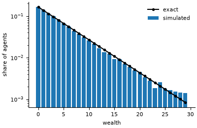

# Boltzmann wealth exchange

**Field:** economics · **Zoo name:** `kinetic_wealth` · **Module:** `modelly.zoo.kinetic_wealth.model`



`n` agents start with `money` units each. Every step they are split into random pairs, each
pair picks a direction at random, and the giver passes one unit to the other if it has any.
Money is conserved and nobody goes into debt, yet equal shares turn into an exponential
(Boltzmann-Gibbs) distribution of wealth.

## How it is written

Wealth is a `Column` on the `Holder` agent class, so a step is a handful of numpy operations
on the whole table: one random permutation gives the pairs, one Bernoulli vector the
directions, and a mask the givers that hold a unit. No agent is visited in a Python loop.

```python
from modelly.zoo.kinetic_wealth.model import KineticScenario, KineticWealth

model = KineticWealth(KineticScenario(rng=42))
model.run()
model.wealth  # every agent's wealth, a numpy view
model.stationary_distribution()  # exact P(w = k)
model.datacollector.get_model_vars_dataframe()  # Gini per step
```

| Parameter | Default | Meaning |
|---|---|---|
| `n` | `1000` | number of agents |
| `money` | `5` | units every agent starts with (the mean wealth) |
| `steps` | `1000` | run length of `run()` |

## Validation

The exchange chain is symmetric: a transfer and its reverse have the same probability. Its
stationary law is therefore uniform over every way of sharing the `M = n * money` units,
and one agent's wealth has the exact marginal
`P(w = k) = C(M - k + n - 2, n - 2) / C(M + n - 1, n - 1)`, which tends to the geometric law
of mean `money`; its Gini coefficient tends to one half.

`tests/zoo/test_kinetic_wealth.py` runs 1,000 agents for 500 steps of burn-in, then takes
twenty snapshots 25 steps apart, with three seeds. The mean Gini must be within three
single-snapshot standard deviations of the exact law's Gini (the mean of correlated
snapshots varies less than one snapshot), and the pooled histogram must be closer to the
exact marginal, in total variation, than the expected distance of a single histogram of
1,000 independent draws. It also checks conservation of money with an odd population and
that the same seed gives the same run.

## References

- Dragulescu, A. and Yakovenko, V. M. (2000). Statistical mechanics of money. *European
  Physical Journal B*, 17, 723-729.

Start a project from it with `modelly zoo copy kinetic_wealth my_economy`.
