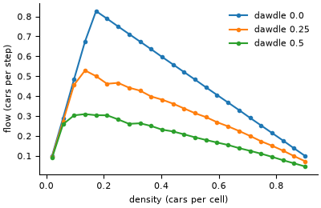

# Nagel-Schreckenberg traffic

**Field:** transport · **Zoo name:** `nagel_schreckenberg` · **Module:** `modelly.zoo.nagel_schreckenberg.model`



A single-lane ring road of `length` cells, each holding at most one car. Every step, all cars
update in parallel: accelerate by one up to `max_speed`, brake to the number of empty cells
ahead, slow down by one with probability `dawdle`, then move. Jams form spontaneously and
travel backwards, against the traffic.

## How it is written

Cars are `Car` agents whose `position` and `velocity` are `Column` attributes. The whole road
updates with a few numpy operations on `model.columns[Car]`: the gap to the car ahead is
`roll(position, -1) - position - 1` modulo the road length, since cars never overtake and the
rows therefore stay in road order. `fundamental_diagram(densities, transient, measured, ...)`
measures the mean flow at each density.

```python
from modelly.zoo.nagel_schreckenberg.model import (
    NagelSchreckenberg,
    TrafficScenario,
    fundamental_diagram,
)

model = NagelSchreckenberg(TrafficScenario(rng=42))
model.run()
model.datacollector.get_model_vars_dataframe()  # flow and mean speed per step
fundamental_diagram([0.05, 0.1, 0.2, 0.4], 300, 200, rng=1)
```

| Parameter | Default | Meaning |
|---|---|---|
| `length` | `1000` | cells of the ring road |
| `density` | `0.15` | share of cells holding a car |
| `max_speed` | `5` | speed limit, cells per step |
| `dawdle` | `0.25` | probability per step of slowing down by one at random |
| `steps` | `500` | run length of `run()` |

## Validation

The fundamental diagram, flow (cars passing a point per step, `density * mean speed`) against
density. `tests/zoo/test_nagel_schreckenberg.py` checks that:

- without dawdling, the steady flow is exactly `min(density * max_speed, 1 - density)` at seven
  densities on both sides of the critical density `1 / (max_speed + 1)`;
- with dawdling, the flow peaks at an interior density and falls steadily on the jammed branch;
- at low density every car runs at `max_speed - Bernoulli(dawdle)`, so the flow is
  `density * (max_speed - dawdle)` within five standard deviations of the mean of independent
  Bernoulli draws;
- cars never share a cell, impossible densities are rejected, and the same seed gives the same
  run.

## References

- Nagel, K. and Schreckenberg, M. (1992). A cellular automaton model for freeway traffic.
  *Journal de Physique I*, 2(12), 2221-2229.

Start a project from it with `modelly zoo copy nagel_schreckenberg my_traffic`.
