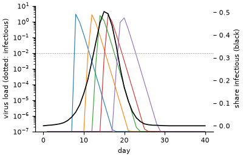

# Within-host and between-host epidemic

**Field:** epidemiology · **Zoo name:** `within_host` · **Module:** `modelly.zoo.within_host.model`



Every host carries its own infection as three ODEs, the target-cell-limited model of influenza
(Baccam et al., 2006): target cells `T`, infected cells `I` and virus `V`, with
`T' = -beta T V`, `I' = beta T V - delta I` and `V' = p I - c V`. The infection rate `beta` is
drawn per host from a lognormal law; `delta`, `p` and `c` are shared. A host is infectious
while its virus load is above `threshold`. Between hosts, a daily phase exposes each
susceptible with probability `1 - exp(-contacts * transmissibility * share infectious)` and
seeds its virus at `exposure_dose`. The two scales meet in both directions: the outbreak sets
who is exposed when, and each host's viral course sets when it is infectious.

## How it is written

The state of the infections lives in the hosts' columns, and one
[`AgentODE`](../agent_odes.md) integrates all of them each day: every host takes the adaptive
steps its own `solve_ivp` call would take, while the right-hand side runs once per stage for
the whole population. The moments a host's virus rises through the threshold and falls back
are [events](../agent_odes.md#events), located on the solver's interpolant, so each host's
onset and clearance are known to the instant (`Host.onset`, `Host.cleared`) instead of being
rounded to the day.

```python
from modelly.zoo.within_host.model import Host, WithinHost, WithinHostScenario

model = WithinHost(WithinHostScenario(rng=1, hosts=100_000))
model.run()  # 60 days
model.attack_rate()
model.columns[Host].onset  # when each host became infectious, to the instant
model.datacollector.get_model_vars_dataframe()  # exposed, infectious, mean virus per day
```

| Parameter | Default | Meaning |
|---|---|---|
| `hosts` | `10000` | number of hosts |
| `index_cases` | `10` | hosts infected at the start, with `index_dose` |
| `contacts` | `8.0` | contacts per host per day |
| `transmissibility` | `0.1` | chance that a contact with an infectious host exposes |
| `beta_median`, `beta_spread` | `10.0`, `0.5` | lognormal law of the infection rate (median, sigma) |
| `death` | `2.0` | `delta`, death rate of infected cells per day |
| `production` | `20.0` | `p`, virions per infected cell per day (relative units) |
| `clearance` | `3.0` | `c`, clearance rate of the virus per day |
| `threshold` | `0.01` | virus load above which a host is infectious |
| `exposure_dose`, `index_dose` | `1e-6`, `1e-3` | virus load given at exposure and to index cases |
| `rtol`, `atol` | `1e-6`, `1e-9` | integration tolerances |
| `days` | `60` | run length of `run()` |

The viral parameters are of the order Baccam et al. fitted for influenza A, in relative units;
the contact parameters are illustrative.

## Performance

A hundred thousand hosts run the sixty days in about 14 seconds on a laptop core. On the
twentieth day, with half the hosts exposed, one day of the batch takes 0.62 s where one
`solve_ivp` call per exposed host takes 21.2 s, 34 times longer, and the two agree to
4e-9 of the tolerance (`benchmarks/ode/within_host.py`, results in `within_host.json`).
The [ODE guide](../agent_odes.md#performance) compares the batch with the loop and with one
stacked `solve_ivp` call at every population size.

## Validation

`tests/zoo/test_within_host.py` checks the integration against `scipy.integrate.solve_ivp`
and against a closed form:

- one day of the whole population equals one `solve_ivp` call per exposed host, same method
  and tolerances, to round-off, and each onset located during the day equals the crossing
  `solve_ivp`'s own event finds;
- a host with no target cells clears its virus exponentially, `V(t) = V0 exp(-c t)`, so it
  falls through the threshold at `log(V0 / threshold) / c`; the clearance times of fifty hosts
  with loads from 0.02 to 5 match it to a relative 1e-6;
- target and infected cells stay in `[0, 1]` and their sum never grows;
- an outbreak needs contacts: with them most hosts are exposed, without them only the index
  cases;
- the same seed gives the same outbreak, straight or resumed from a checkpoint, bit for bit.

```{include} cards/within_host.md
```

## References

- Baccam, P., Beauchemin, C., Macken, C. A., Hayden, F. G. and Perelson, A. S. (2006).
  Kinetics of influenza A virus infection in humans. *Journal of Virology*, 80(15),
  7590-7599.
- Hairer, E., Norsett, S. P. and Wanner, G. (1993). *Solving Ordinary Differential Equations
  I: Nonstiff Problems*, 2nd ed. Springer.
- Mideo, N., Alizon, S. and Day, T. (2008). Linking within- and between-host dynamics in the
  evolutionary epidemiology of infectious diseases. *Trends in Ecology and Evolution*, 23(9),
  511-517.

Start a project from it with `modelly zoo copy within_host my_outbreak`.
